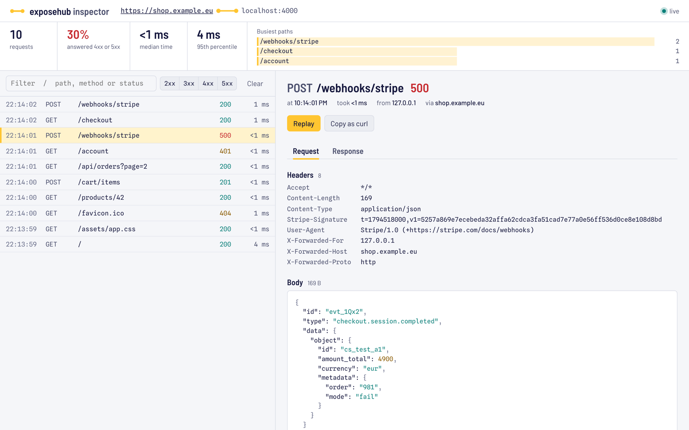
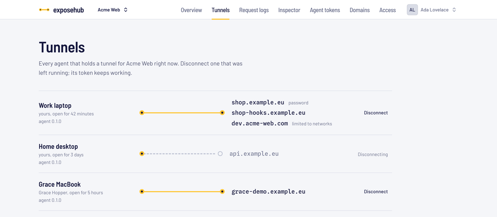

# exposehub

**Self-hosted tunnels for your team.**

exposehub puts a service running on your machine under a public HTTPS address, through a tunnel server you run yourself. One install serves a whole team: addresses that stay the same, your own domains, a request inspector, and rules for who may reach each tunnel.

[Self-hosting](#self-hosting) · [Documentation](#documentation) · [How it compares](#how-it-compares) · [Licence](#licence)


Status: 0.x. It runs a team's daily tunnels for HTTP and WebSocket traffic, but settings and APIs may still change between minor versions; [CHANGELOG.md](CHANGELOG.md) says what changed. exposehub is open source under the [Apache License 2.0](LICENSE).

## Quick start

With a tunnel server running (see [Self-hosting](#self-hosting)), on your own machine:

```sh
curl -fsSL https://connect.example.eu/install.sh | sh   # the agent, from your own server
exposehub login                                         # asks for a token from the dashboard
exposehub http 3000 --subdomain shop
```

```
Inspector   http://127.0.0.1:4040
Forwarding  https://shop.example.eu  ->  http://localhost:3000
Logging     a summary of each request goes to your request log in the dashboard (--no-log to stop)
19:23:21  GET     200      6ms  /
```

> **The address is public.** Anyone who knows it reaches your local service. Add `--auth name:password` or `--allow 203.0.113.0/24` to limit who gets in; the tunnel server checks both before a request reaches your machine.

No server yet? [Try it locally](#try-it-locally) runs server, agent and a test service on `*.localhost`, without DNS or certificates.

## Why exposehub

- **Your app works through it.** Streaming responses and WebSockets pass through unbuffered, and Vite, webpack and Next.js dev servers work without touching their configuration, hot reload included. What is covered, and what is not, is listed [below](#what-passes-through).
- **Addresses that stay.** Pick a subdomain, save it for your team, or connect a domain of your own. The agent keeps its address across reconnects, so webhook and OAuth callback URLs survive a restart.
- **No warning page.** Visitors and webhook senders reach your service directly. Protection is a choice per tunnel: a password or a list of networks, enforced on the server.
- **An inspector on your machine.** Every request with headers and bodies at `127.0.0.1:4040`, with replay and copy as `curl`, and a JSON API for scripts. Nothing of it leaves the machine.
- **Made for a team.** Teams, one token per machine, request logs with secrets redacted, a Tunnels page to close one you left running at home, and an admin area with an audit log.
- **Self-hosting in one script.** `install.sh` and Docker Compose on one Linux server, with certificates issued automatically, or a Helm chart for Kubernetes. Every setting is an environment variable.

The inspector on your own machine, with a webhook that failed opened for a closer look and a replay:

<picture>
  <source media="(prefers-color-scheme: dark)" srcset="docs/images/inspector-dark.png">
  
</picture>

The dashboard's Tunnels page, where a team sees what is connected and disconnects a tunnel someone left running:

<picture>
  <source media="(prefers-color-scheme: dark)" srcset="docs/images/tunnels-dark.png">
  
</picture>

## What passes through

| Traffic | Works | Checked by |
|---|---|---|
| HTTP requests and responses, large uploads and downloads | yes | end-to-end tests |
| Streaming responses, such as Server-Sent Events | yes, unbuffered | end-to-end test |
| WebSockets | yes | end-to-end test |
| Vite dev server with hot reload | yes, no configuration | run against Vite 8.3, plus an end-to-end test |
| webpack-dev-server with hot reload | yes, no configuration | run against webpack-dev-server with webpack 5.112, plus an end-to-end test |
| Next.js dev server with hot reload | yes, no configuration | run against Next.js 16.4 in a headless browser, plus an end-to-end test |
| gRPC, HTTP/2 to the local service | no | the tunnel speaks HTTP/1.1 to the local service |
| Plain TCP or UDP | no | HTTP only |

The end-to-end tests are in [`tunnel/internal/e2e`](tunnel/internal/e2e); `go test ./...` in `tunnel/` runs them.

## How it compares

| | exposehub | ngrok | Cloudflare Tunnel | frp |
|---|---|---|---|---|
| Runs on | your server | ngrok's cloud | Cloudflare's network | your server |
| Account | on your own install | at ngrok | none for Quick Tunnels, at Cloudflare for named ones | none |
| Stable address | saved subdomains and your own domains | one assigned on the free plan | named tunnels only; Quick Tunnels get a new name each start | yes, by configuration |
| Warning page | none | on free endpoints, for browsers | none | none |
| Request inspector | local, with replay | local, with replay | no | no |
| Certificates | automatic | managed | managed | yours to set up |
| TCP, UDP, gRPC | no | yes | partly | yes |
| Licence | Apache-2.0 | proprietary | client Apache-2.0 | Apache-2.0 |
| Made for | a team sharing dev servers and webhooks from its own infrastructure | sharing something quickly without running a server | services that sit behind Cloudflare anyway | any protocol, driven by configuration files |

As of November 2026, from each project's documentation and issue tracker; corrections are welcome. If you need TCP, UDP or gRPC, or do not want to run a server, one of the others is the better choice.

## Self-hosting

One Linux server with Docker and two DNS records:

```sh
git clone --branch v0.3.2 https://github.com/jkbennemann/exposehub.git
cd exposehub/deploy/compose
./install.sh
docker compose up -d --wait
```

`install.sh` asks for your domains and email address, generates the secrets, checks your DNS and pulls the images. Caddy, included, gets the certificates: a wildcard for the tunnel domain through your DNS provider's API, or one certificate per name without one. Upgrading means checking out a newer tag and running the script again. The full guide, with DNS, certificate modes, backups and a tunnels-only mode without the dashboard, is [docs/self-hosting/compose.md](docs/self-hosting/compose.md).

On Kubernetes, install the Helm chart from `oci://ghcr.io/jkbennemann/charts/exposehub`; see [docs/self-hosting/kubernetes.md](docs/self-hosting/kubernetes.md).

Every release publishes `ghcr.io/jkbennemann/exposehub-server`, `-web` and `-caddy` for amd64 and arm64, the chart, and the agent binaries, all with the same version.

## How it works

```
visitor ── HTTPS ──▶ Caddy ──▶ tunnel server ◀══ one WebSocket, a stream per request ══ agent ──▶ localhost:3000
                               ▲                                                       (your machine)
                               │ tokens, domains, access rules
                               dashboard
```

The agent dials out to the tunnel server, so the machine behind it needs no open port. The server routes each public hostname to the agent that holds it. The dashboard, a Laravel application, keeps accounts, teams, tokens, domains and request logs; the server mirrors what it needs from it, and keeps serving through a short dashboard outage (five minutes by default). Without the dashboard, the server runs alone with a static token list.

## Security

- A tunnel is public by design. Passwords (`--auth`) and network rules (`--allow`, and the dashboard's Access page) are checked on the tunnel server, before a request reaches your machine.
- The tunnel server sees traffic in the clear, as any reverse proxy does. That is why you run it yourself.
- Tunnels of all teams share one tunnel domain, and a name can pass from one team to another. [docs/server.md](docs/server.md) says what that means and when to give teams their own domain.

Report vulnerabilities privately, as described in [SECURITY.md](SECURITY.md).

## Documentation

- [docs/agent.md](docs/agent.md): the `exposehub` command, several tunnels, `exposehub.yml`, the inspector and its API, dev servers
- [docs/self-hosting/compose.md](docs/self-hosting/compose.md) and [docs/self-hosting/kubernetes.md](docs/self-hosting/kubernetes.md): installing, DNS, certificates, backups, upgrades
- [docs/server.md](docs/server.md): every setting of the tunnel server
- [docs/admin.md](docs/admin.md): the admin area and the limits an operator can change
- Each install also serves a user guide at `/docs`, with its own addresses filled in

## Try it locally

You need Go 1.26 or newer. `*.localhost` resolves to your own machine in curl and in browsers, so no DNS setup is needed.

```sh
cd tunnel
go build -o bin/ ./cmd/...

# 1. the tunnel server
EXPOSEHUB_LISTEN=:8080 \
EXPOSEHUB_AGENT_HOST=localhost \
EXPOSEHUB_TUNNEL_DOMAINS=localhost \
EXPOSEHUB_STATIC_TOKENS=me:dev-token \
bin/exposehub-server

# 2. something to expose
python3 -m http.server 8000

# 3. the agent
bin/exposehub http 8000 --server http://localhost:8080 --token dev-token --subdomain demo

curl http://demo.localhost:8080/
```

## Feature requests

Missing something? [Request a feature](https://github.com/jkbennemann/exposehub/issues/new?template=feature_request.yml). The form is short: the problem you have, which part of exposehub it concerns and how you use it. An idea of how it could work is welcome and not required.

Look through the [open requests](https://github.com/jkbennemann/exposehub/issues?q=is%3Aissue+is%3Aopen+label%3Aenhancement+sort%3Areactions-%2B1-desc) first. A 👍 on one that is already there shows that more than one person needs it, and the list is sorted by them. Something that does not work as described is a [bug report](https://github.com/jkbennemann/exposehub/issues/new?template=bug_report.yml) instead, and security problems go through [SECURITY.md](SECURITY.md).

## Contributing

Contributions are welcome. [CONTRIBUTING.md](CONTRIBUTING.md) covers the setup, the tests and the licence your contribution comes in under, and [CODE_OF_CONDUCT.md](CODE_OF_CONDUCT.md) how we treat each other.

## Support

If exposehub is useful to you, you can support its development at [buymeacoffee.com/jkbennemann](https://buymeacoffee.com/jkbennemann).

## Layout

- `tunnel/` — Go module with the server (`cmd/exposehub-server`) and the agent (`cmd/exposehub`)
- `web/` — Laravel dashboard: accounts, teams, agent tokens, domains, request logs and the admin area
- `deploy/compose/` — Docker Compose setup and `install.sh`; `deploy/caddy/` builds its Caddy image
- `deploy/helm/exposehub/` — Helm chart
- `docs/self-hosting/` — guides for both

## Licence

exposehub is open source under the [Apache License, Version 2.0](LICENSE). In short, and the licence text is what counts:

- You may use, change, self-host and pass on exposehub for any purpose, commercial ones included.
- Copies you pass on keep the licence and the [NOTICE](NOTICE) file, and files you changed say so.
- The licence gives no right to the name "exposehub" beyond saying where the software comes from (section 6).

Version 0.1.0 was published under the Functional Source License (FSL-1.1-ALv2); every version from 0.1.1 on is under Apache-2.0.
